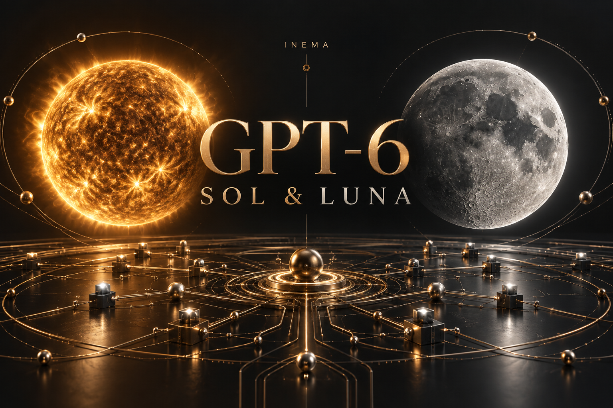

# GPT-6 Sol & Luna ê¢â‚¬â€ ObservatêƒÂ³rio ARCKHê‰

<div align="center">
  
  <p><strong>Arckhé AI</strong></p>
</div>


Pesquisa do lanêƒÂ§amento de 22/09/2026, comparaêƒÂ§êƒÂµes e planejamento de integraêƒÂ§êƒÂ£o.

**[Abrir guia e simulador](https://linnoff88-dev.github.io/

**Idiomas:** [PortuguêƒÂªs](https://linnoff88-dev.github.io/ ê‚· [English](https://linnoff88-dev.github.io/ ê‚· [EspaêƒÂ±ol](https://linnoff88-dev.github.io/



## Entregas

- AnêƒÂ¡lise em portuguêƒÂªs, inglêƒÂªs e espanhol com 11 referêƒÂªncias oficiais e recomendaêƒÂ§êƒÂµes ARCKHê‰ identificadas.
- GrêƒÂ¡fico de preêƒÂ§os e trêƒÂªs avaliaêƒÂ§êƒÂµes selecionêƒÂ¡veis, com esforêƒÂ§o e metodologia.
- Calculadora de texto: entrada comum, leitura/gravaêƒÂ§êƒÂ£o de cache, contexto longo, modalidade e roteamento/revisêƒÂ£o.
- Gerador local de JSON para Responses; nêƒÂ£o envia requisiêƒÂ§êƒÂµes.
- Plano para atendimento, busca, bots, conteêƒÂºdo, WebMCP e mêƒÂ­dia.
- Dados editêƒÂ¡veis em `data/research.json` e exportaêƒÂ§êƒÂµes CSV.

## Executar

```sh
python3 -m http.server 8080
# http://localhost:8080/guia/
node scripts/verify.mjs
```

HTML/CSS/JavaScript sem build ou dependêƒÂªncias de runtime. Fontes Google têƒÂªm fallback local. Nenhuma chave de API êƒÂ© necessêƒÂ¡ria. O conteêƒÂºdo de `data/research.json` tambêƒÂ©m estêƒÂ¡ embutido no HTML para funcionar sem fetch; o verificador acusa divergêƒÂªncias.

## Limites

Os benchmarks sêƒÂ£o publicados pela OpenAI, nêƒÂ£o reproduzidos neste projeto. O simulador estima custo de tokens; nêƒÂ£o mede qualidade nem latêƒÂªncia, nem inclui ferramentas e mêƒÂ­dia. Exemplos de API foram revisados contra documentaêƒÂ§êƒÂ£o, mas nêƒÂ£o executados com uma chave. Nenhuma integraêƒÂ§êƒÂ£o de produêƒÂ§êƒÂ£o foi ativada.

Capa gerada na ferramenta de imagem embutida do Codex, com pedido de GPT Image 2.5; o retorno e os metadados nêƒÂ£o expêƒÂµem a subversêƒÂ£o. NêƒÂ£o êƒÂ© possêƒÂ­vel certificar 2.5. Prompt e proveniêƒÂªncia em [docs/imagem.md](docs/imagem.md).

VersêƒÂ£o: **1.1.1**. Pesquisa consultada em **2026-09-22**.

## ManutenêƒÂ§êƒÂ£o multilêƒÂ­ngue

Fonte editorial: `i18n/source/pt.html`; textos e traduêƒÂ§êƒÂµes revisadas em `i18n/source/pt.json` e `i18n/translations/{en,es}.json`. Chaves sêƒÂ£o hashes do texto original; textos novos exigem traduêƒÂ§êƒÂ£o explêƒÂ­cita. NêƒÂ£o editar as pêƒÂ¡ginas geradas diretamente.

```sh
python3 scripts/build-i18n.py
node scripts/verify.mjs
```

O gerador compartilha estrutura, lêƒÂ³gica e imagens. Traduz conteêƒÂºdo, acessibilidade, metadados, notas dos grêƒÂ¡ficos, validaêƒÂ§êƒÂµes e exemplos. MantêƒÂ©m os IDs de modelos, endpoints, chaves JSON e valores de benchmark. A troca de idioma preserva a seêƒÂ§êƒÂ£o e os campos do simulador na mesma aba. A URL determina o idioma; nêƒÂ£o hêƒÂ¡ redirecionamento automêƒÂ¡tico.

As exportaêƒÂ§êƒÂµes de dados usam identificadores estêƒÂ¡veis; o README e os documentos têƒÂ©cnicos do repositêƒÂ³rio permanecem em portuguêƒÂªs. A traduêƒÂ§êƒÂ£o nêƒÂ£o atualiza a pesquisa original de 22/09/2026. Nenhuma API de traduêƒÂ§êƒÂ£o foi chamada: custo de API de traduêƒÂ§êƒÂ£o US$ 0; consumo do agente nêƒÂ£o medido.

---

<div align="center">
  
  <p><strong>Arckhé AI</strong></p>
</div>